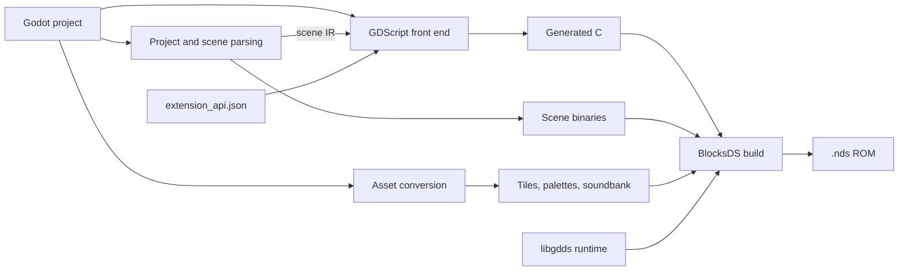

# Architecture

gd2nds is a Rust host compiler plus a C runtime library, `libgdds`. The compiler turns a Godot project into C sources and DS binary data; BlocksDS compiles and links them into a ROM.

## Pipeline

`gd2nds build path/to/project` runs three lanes and joins them in one BlocksDS build.



The lanes are not fully independent: the GDScript front end reads the scene IR to type `$Node` paths and exported properties, and it reads a pinned `extension_api.json` for Godot's built-in class signatures.

## DS hardware constraints

The DS is small enough that the compiler, not the game author, must enforce most limits, failing the build with a clear message when a project exceeds them.

| Resource | Limit | Design consequence |
|---|---|---|
| CPU | ARM9 at 67 MHz (game code), ARM7 at 33 MHz (sound, input, Wi-Fi) | All generated code runs on ARM9; ARM7 runs the stock BlocksDS/Maxmod binary |
| Floating point | No FPU | Fixed point by default; avoid `float` in hot paths |
| Main RAM | 4 MB (8 MB on DSi) | Scenes load from NitroFS on demand |
| Fast RAM | 32 KB ITCM, 16 KB DTCM | Per-frame node update loop and maths helpers live in ITCM |
| VRAM | 656 KB in banks A to I | Bank assignment planned per scene; scenes that don't fit are rejected |
| Screens | Two, 256 x 192 each | Project setting picks top, bottom or both |
| 2D engines | Main and sub, each with 4 background layers and 128 OAM sprites | Sprite budget checked at build time |
| Sprite sizes | 8 to 64 px per side, 16 or 256 colours | Larger `Sprite2D` textures are split into several OAM entries |
| Affine | 32 rotation/scale matrices per engine | `rotation` and non-1 `scale` use a shared matrix slot |
| ROM size | Up to 512 MB | Assets stored LZ77-compressed in NitroFS |
| Input | D-pad, A/B/X/Y, L/R, Start/Select, touch | `InputMap` actions map to buttons; touch as mouse events |

## Project and scene parsing

All Godot 4 text resources share one INI-like grammar, so one tokenizer serves `project.godot`, `.tscn`, `.tres` and `.import` files. The parser builds a resource graph keyed by `uid://` and `res://` paths.

- **project.godot**: `config/name`, `run/main_scene`, `[autoload]` singletons, `[input]` action maps, `[display]` size and stretch mode, and `[rendering]` texture filter.
- **.tscn (format=3)**: `[ext_resource]`, `[sub_resource]` and `[node]` sections. Property values use Godot's constructor syntax (`Vector2(1, 2)`, `ExtResource("1_abc")`, arrays, dictionaries, `&"StringName"`) and are read by a small expression parser.
- **Instanced scenes** are expanded recursively with property overrides applied on top.
- **.tres**: `SpriteFrames`, `TileSet`, `AtlasTexture`, `Animation` and shape resources.
- **.import files** are read only to find the source image and its flags; conversion uses the original PNG.

The output is a typed scene IR: a flat node table per scene with parent indices, resolved property values, the attached script class and signal connections.

## GDScript to C

Each `.gd` file becomes one C struct (the instance fields) plus one `.c` file of functions, compiled in four passes.

1. **Lex and parse.** An indentation-aware lexer and a recursive-descent parser for GDScript 4: `extends`, `class_name`, `@export`, `@onready`, `signal`, `enum`, `const`, typed `var`, `func`, lambdas, `match`, `await`, `super`, and `$Path` / `%Unique` node access.
2. **Resolve and type-check.** A class table built from `class_name` declarations and Godot's `extension_api.json`. Inferred types (`:=`) are resolved here; anything left untyped becomes `Variant`.
3. **Lower to IR.** A small typed IR. `for x in range(n)` becomes a counted loop, string formatting becomes runtime calls, signals become callback tables, and `$Node` becomes a pointer cached in `_ready`.
4. **Emit C.** Plain C99, one function per method with `self` first. Virtual dispatch goes through a per-class vtable, and built-in calls map to runtime functions such as `gd_node2d_set_position(self, v)`.

### Type model

| GDScript type | C on DS | Notes |
|---|---|---|
| `int` | `int32_t` | Godot uses 64-bit; option for `int64_t` |
| `float` | `fx32` (20.12 fixed point) | Option for soft-float `double` |
| `bool` | `bool` | |
| `Vector2`, `Vector2i`, `Rect2`, `Color` | Small structs by value | `Vector2` uses `fx32` fields |
| `String`, `StringName` | Ref-counted UTF-8; `StringName` interned at compile time | Avoid building strings in `_process` |
| `Array`, `Dictionary` | Ref-counted `Variant` containers; `Array[T]` packed | |
| `Node`, `Resource` | Pointers; `queue_free` or ref counting | No tracing GC |
| Untyped | `Variant` (tag + 8-byte payload) | Dynamic dispatch through a name table |

!!! info "Not supported in the MVP"
    `await` on arbitrary signals, `call()`/`get()` by string on user methods, `load()` of runtime-computed paths, and `@tool` scripts. Each is reported as an error with file and line.

## Runtime

`libgdds` is a C library of roughly 5,000 to 10,000 lines that recreates just enough of Godot's `SceneTree` for compiled scripts to run. It is not a port of Godot.

- **Frame loop.** At 60 Hz, locked to VBlank: read input, run `_process(delta)` in tree order, run `_physics_process` at the physics tick, update dirty transforms, then write OAM and background registers during VBlank.
- **Scene tree.** Nodes live in a per-scene pool. Constant `get_node()` paths are resolved to indices at compile time. `change_scene_to_file()` frees the pool and loads the next scene from NitroFS.
- **Draw order.** `z_index` and tree order map to the four OAM priority levels plus background priority; sprites are sorted by z each frame.
- **Input.** Action checks compile to bitmask tests.
- **Signals.** Connections go into a per-node callback list; `emit_signal` with a constant name is a direct loop over it.

| Godot node | DS mapping | MVP |
|---|---|---|
| `Node`, `Node2D` | Tree entry with fixed-point 2D transform | Yes |
| `Sprite2D` | One or more OAM entries; flips via OAM bits; rotation/scale via affine slot | Yes |
| `AnimatedSprite2D` | Like `Sprite2D`, frames swapped by OAM tile index | Yes |
| `TileMapLayer` | Tiled background layer; large maps streamed with the camera | Yes |
| `Camera2D` | Background scroll and sprite offset, with limits and smoothing | Yes |
| `Timer` | Countdown in frames, emits `timeout` | Yes |
| `CanvasLayer` | Fixed layer unaffected by the camera | Later |
| `Label` | Bitmap font drawn into a background layer | Later |
| `ColorRect`, `Panel` | Solid colour background tiles | Later |
| `Area2D`, `CollisionShape2D`, `CharacterBody2D` | Small AABB/circle physics, `move_and_slide` on tiles | Later |
| `AudioStreamPlayer` | Maxmod sound effects and music | Later |

## Asset conversion

The compiler converts sprites, palettes and scene data itself in Rust, and calls BlocksDS tools where they already do the job well. Every output is cached by content hash.

| Source | Conversion | Tool |
|---|---|---|
| Sprite PNGs | 4 bpp if possible, else 8 bpp; 8x8 tiles in OAM shape order; shared palettes per scene | `grit` or the `image` crate |
| `TileSet` atlas | 8x8 tiles, duplicates and flips removed, 4 bpp with up to 16 sub-palettes | `grit` |
| `TileMapLayer` data | Godot's packed `tile_map_data` decoded to DS screen-block entries | Compiler |
| Fonts | Rasterised to a 1 or 4 bpp bitmap font | `fontdue` crate |
| `.wav` | Resampled to at most 32 kHz mono, packed in a soundbank | `mmutil` |
| `.it`, `.xm`, `.mod`, `.s3m` | Packed as music in the soundbank | `mmutil` |
| Scenes | Compact binary node tables, LZ77-compressed | Compiler |

Texture filtering is ignored, since the DS samples nearest-neighbour only.

## Repository layout

```text
gd2nds/
  crates/
    gd2nds-cli/          # the gd2nds command
    gd2nds-project/      # parsers for project.godot, .tscn, .tres, .import
    gd2nds-gdscript/     # lexer, parser, type checker, lowering, C emitter
    gd2nds-assets/       # sprites, tilesets, fonts, audio, scene packing
    gd2nds-budget/       # VRAM, OAM and RAM checks and the size report
  runtime/               # libgdds, C99, built with BlocksDS
  templates/rom/         # Makefile and main.c the generated code drops into
  api/extension_api.json # pinned dump from Godot 4.7
  tests/                 # GDScript golden tests and Godot test projects
```

## Risks

| Risk | Mitigation |
|---|---|
| GDScript semantics change between 4.x releases | Pin Godot 4.7 and its `extension_api.json`; test in CI |
| Fixed point breaks game logic | Soft-float option; warnings on out-of-range literals |
| Dynamic code defeats static compilation | `Variant` fallback; clear errors for the rest |
| VRAM and OAM limits | Build-time budget report naming the offending assets |
| Scope creep | One table of every supported class and method; unlisted calls are compile errors |
